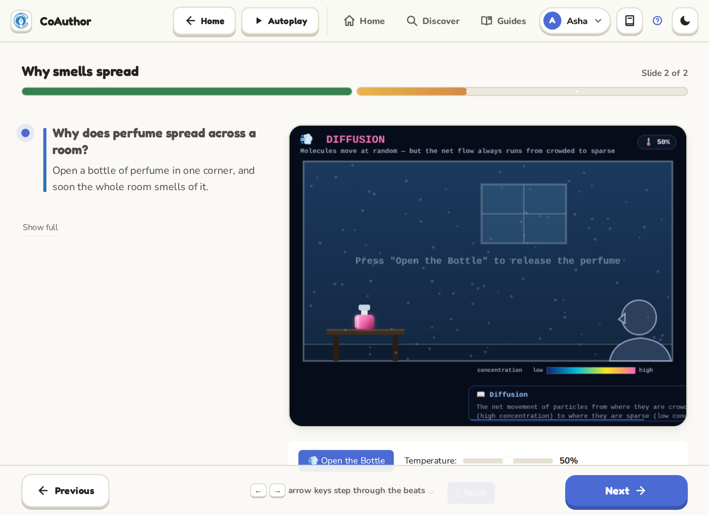
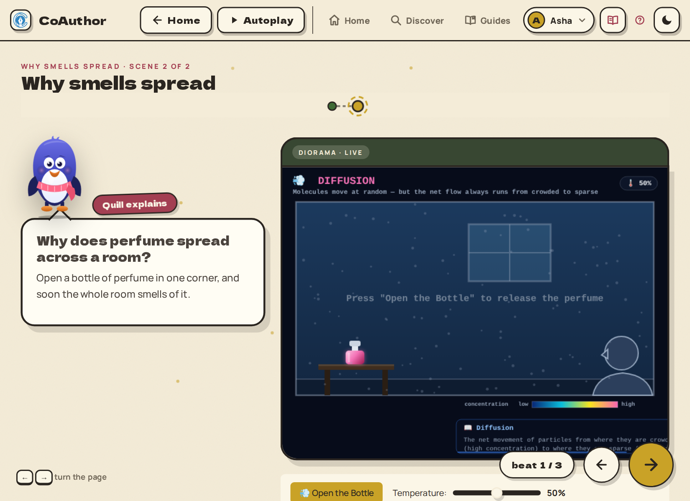

CoAuthor can show the same lesson in two looks. The questions, the simulations and your progress are the same in both. Only the way the page looks changes.

## The two looks

- **Classic** - clean, simple slides on light or dark paper. Good for quick revision and for reading on a small screen.
- **Story** - the lesson as a comic story, with ink outlines, paper textures and characters. Good when you want to settle in and read.

## How to switch

Tap the **book** button in the top bar.

- A **closed book** means Classic is on. Tap it to open the story.
- An **open book** means Story is on. Tap it to go back to Classic.

The app remembers your choice for your profile, so the next lesson opens in the same look.

> [!TIP]
> The sun and moon button next to it is a different switch. It changes between the light and dark theme, in either look.

## Story-only courses

Some courses are written as one long story, with characters who come back from lesson to lesson. Those courses always open in the story look, and the book button is hidden while you are in them. When you leave the course, your own choice comes back.

## Next

- [Practice tests and reviewing your answers](practice-tests-and-review.md)
