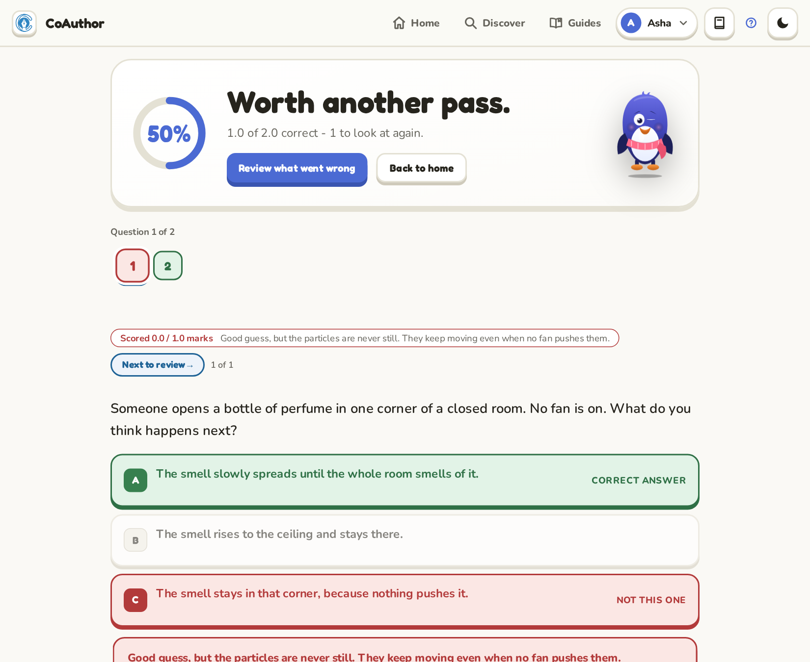

A practice test is a set of questions from your course, like a short exam. A grown-up can build one for you in the Parent area, and some courses come with tests of their own.

## Taking a test

- On your home page, find **Practice tests and quizzes** and choose a test.
- Questions come one at a time. Use **Next** and **Previous** in the top bar to move between them. On a computer, <kbd>Shift</kbd> + <kbd>Right</kbd> and <kbd>Shift</kbd> + <kbd>Left</kbd> do the same.
- You can go back and change an answer before you submit.
- On the last question, press **Submit**. Your answers are marked then, all together.

> [!NOTE]
> In a lesson, a question is checked at once and shows you why. In a test, nothing is marked until you submit. This is closer to a real exam.

## If you stop halfway

Your answers are saved as you go. If you close the app, the test opens where you left it next time.

## Reviewing your answers

After you submit, you see your score and a list of the questions. Open any question to see:

- your answer, and the right answer;
- why the right answer is right;
- for some questions, a worked explanation slide with a picture or a simulation.

Spend most of your time on the questions you got wrong. Read why, then try to explain the idea in your own words before you move on.

> [!TIP]
> A wrong answer in a practice test is useful. It shows you exactly what to revise, before the real exam.

## Next

- [Your progress lives on this device](your-progress-on-this-device.md)
