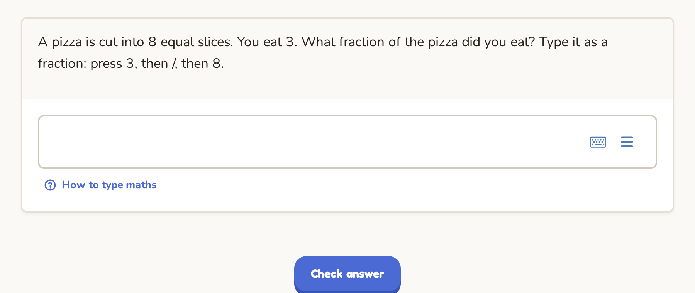

Some questions ask you to type a maths answer, such as a fraction or an expression. They use a special maths box. It looks like a normal text box, but it turns what you type into proper maths as you go.



## The four keys to remember

| To write | Type | You see |
|---|---|---|
| a fraction | <kbd>3</kbd> <kbd>/</kbd> <kbd>4</kbd> | $\frac{3}{4}$ |
| a power | <kbd>x</kbd> <kbd>^</kbd> <kbd>2</kbd> | $x^{2}$ |
| a small number below | <kbd>v</kbd> <kbd>_</kbd> <kbd>1</kbd> | $v_{1}$ |
| a square root | type the letters `sqrt` | $\sqrt{\ }$ |

After a fraction, a power or a root, the cursor stays inside it. Press the <kbd>Right</kbd> arrow key (or <kbd>Tab</kbd>) to move out and carry on typing.

> [!TIP]
> To type the fraction $\frac{x+1}{2}$, put the top part in brackets first: type `(x+1)/2`. The box keeps the brackets out of the way.

## Try it: a fraction

Type three quarters. Press <kbd>3</kbd>, then <kbd>/</kbd>, then <kbd>4</kbd>, then **Check**.

```coauthor-try
{
  "id": "guide-typing-maths-fraction",
  "type": "equation-input@1",
  "stem": "Type **three quarters** as a fraction.",
  "expected": "\\frac{3}{4}"
}
```

Any fraction equal to three quarters is accepted, so $\frac{6}{8}$ is right too. The box checks the value of your answer, not the exact keys you pressed.

## Try it: a power

Type "two to the power five": <kbd>2</kbd> <kbd>^</kbd> <kbd>5</kbd>.

```coauthor-try
{
  "id": "guide-typing-maths-power",
  "type": "equation-input@1",
  "stem": "Type $2$ to the power $5$.",
  "expected": "2^5"
}
```

## Try it: a square root

Type the letters `sqrt`. They turn into a root sign. Then type `49`, press the <kbd>Right</kbd> arrow to leave the root, and type `+1`.

```coauthor-try
{
  "id": "guide-typing-maths-root",
  "type": "equation-input@1",
  "stem": "Type the square root of $49$, plus $1$.",
  "expected": "\\sqrt{49}+1"
}
```

## Other symbols

Type the letters, and the box turns them into the symbol:

- `pi` gives $\pi$
- `theta` gives $\theta$, and `alpha`, `beta` work the same way
- `<=` gives $\le$ and `>=` gives $\ge$
- `*` gives a multiplication dot

## On a phone or tablet

When you tap the maths box, a maths keyboard opens at the bottom of the screen. It has keys for fractions, powers, roots and Greek letters. The small keyboard button on the box opens or closes it.

## When the answer is marked wrong

- Check that the cursor did not stay inside a fraction or a power. For example, $2^{5+1}$ is not the same as $2^{5}+1$.
- Check your brackets: $(x+1)^2$ and $x+1^2$ are different.

## Next

- [Answering descriptive questions](answering-descriptive-questions.md) - long answers, and how they are marked.
